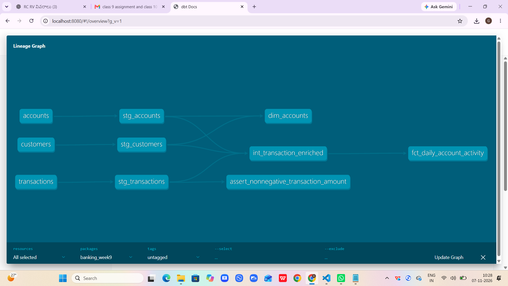



# Week 9 - Banking Analytics using dbt Core and DuckDB


## Project Overview


This project builds a banking analytics data pipeline using dbt Core and DuckDB.


The pipeline loads banking CSV files, cleans and transforms the data, applies data quality tests, and creates analytical tables for reporting.


## Tools and Technologies


- Python

- dbt Core

- DuckDB

- SQL

- Git and GitHub

- GitHub Actions


## Source Data


The project uses three CSV seed files:


- customers.csv - Customer information

- accounts.csv - Bank account information

- transactions.csv - Banking transaction details


The original CSV files are kept unchanged.


## Project Structure


```text

week_09_dbt_project/

    seeds/

        customers.csv

        accounts.csv

        transactions.csv

    models/

        staging/

            stg_customers.sql

            stg_accounts.sql

            stg_transactions.sql

            sources_and_models.yml

        intermediate/

            int_transaction_enriched.sql

        marts/

            dim_accounts.sql

            fct_daily_account_activity.sql

            marts.yml

    tests/

        assert_nonnegative_transaction_amount.sql

    README.md

    requirements.txt

    dbt_project.yml

    profiles.yml.example

```


## Data Pipeline Layers


### 1. Seeds


Loads the original CSV files into DuckDB.


### 2. Staging


Cleans and casts columns into appropriate data types.


Models:

- stg_customers

- stg_accounts

- stg_transactions


### 3. Intermediate


The int_transaction_enriched model joins transactions with account and customer details.


It also calculates signed_amount:


- DEPOSIT = Positive amount

- PURCHASE = Negative amount

- WITHDRAWAL = Negative amount


### 4. Marts


\*\*dim_accounts\*\*


Contains account information along with customer details.


\*\*fct_daily_account_activity\*\*


Provides daily account-level transaction summaries:


- transaction_count

- total_deposits

- total_outflows

- net_amount


## Business Rules and Assumptions


- Each account belongs to one customer.

- Each transaction belongs to one account.

- Transaction amounts are stored as positive magnitudes.

- DEPOSIT represents money coming into an account.

- PURCHASE and WITHDRAWAL represent money going out.

- All transactions use USD currency.

- Net amount is calculated as deposits minus outflows.


## Data Quality Tests


The project includes:


- Unique ID checks

- Not-null checks

- Customer-account relationship checks

- Account-transaction relationship checks

- Accepted transaction type checks

- Custom non-negative transaction amount test


All 10 data quality tests passed successfully.


## Setup Instructions


Install dependencies:


```bash

pip install -r requirements.txt

```


Copy the example profile:


```bash

copy profiles.yml.example profiles.yml

```


Check the dbt connection:


```bash

dbt debug --profiles-dir .

```


Load seed files:


```bash

dbt seed --profiles-dir .

```


Build all models and run tests:


```bash

dbt build --profiles-dir .

```


Generate documentation:


```bash

dbt docs generate --profiles-dir .

```


Open documentation:


```bash

dbt docs serve --profiles-dir .

```


## Validation Results


The complete dbt build completed successfully:


- Seeds: 3

- Models: 6

- Data quality tests: 10

- Total successful operations: 19

- Errors: 0


## Lineage Graph


The dbt lineage graph is shown below.




It shows the dependencies from source seeds through staging and intermediate models to the final marts.


## CI/CD


A GitHub Actions workflow is configured at:


`.github/workflows/week9_dbt_ci.yml`


It runs the dbt build automatically when changes are pushed or a pull request is created for the Week 9 project.


## Issue Investigated

While building `dim_accounts`, dbt reported an ambiguous `customer_id` column because both joined tables contained that column.

I fixed this by qualifying the columns with table aliases, such as `a.customer_id` and `c.customer_name`. After this correction, the model ran successfully.
## Conclusion


This project demonstrates how dbt Core and DuckDB can be used to build a structured banking analytics pipeline with reusable SQL models, data quality tests, documentation, and automated CI validation.


